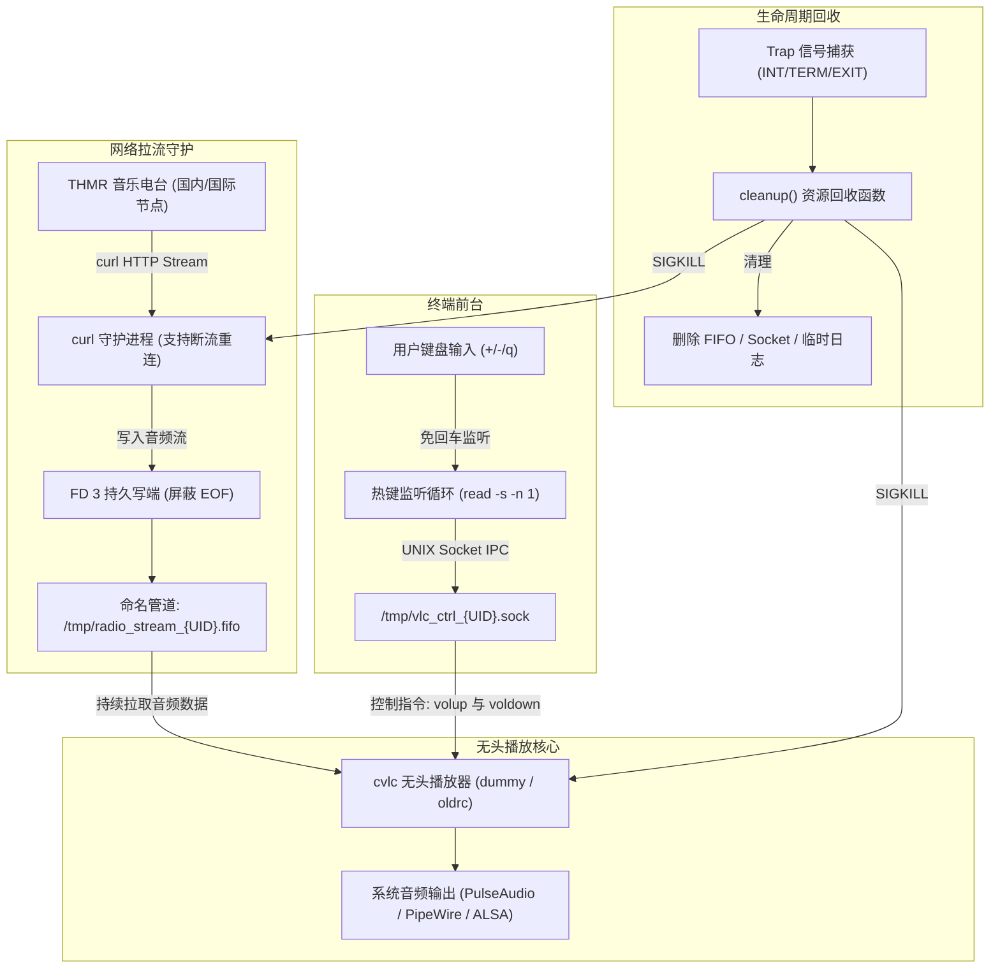
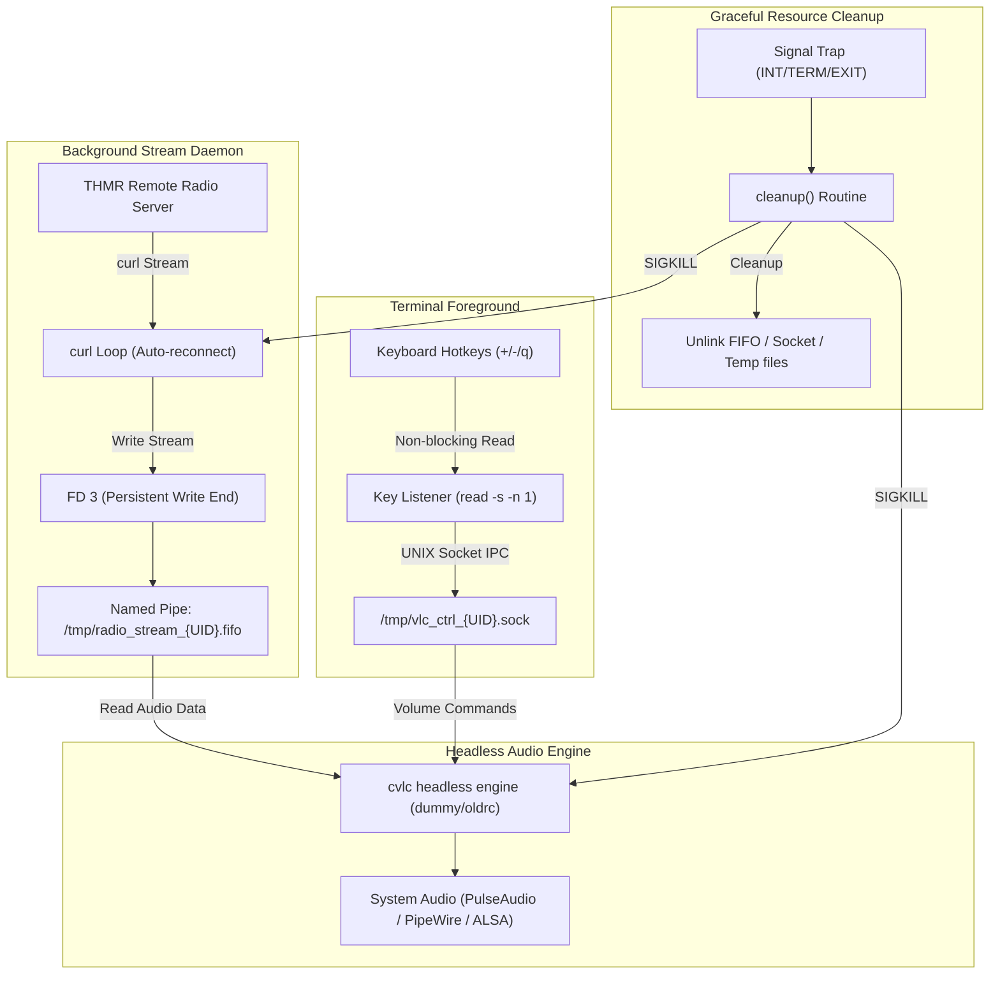

<div align="center">

# thmr-cli

**适用于 [THMR 东方音乐电台 (thmr-app)](https://github.com/Yunmoan/thmr-app) 的 Linux & macOS 命令行轻量级流媒体播放端**

**A lightweight Linux & macOS command-line streaming client for [Touhou Music Radio (thmr-app)](https://github.com/Yunmoan/thmr-app)**

[](LICENSE)
[](#)
[](#)
[](#)

[简体中文](#-简体中文) • [English](#-english) • [English Document](README_EN.md)

</div>

---

## 🇨🇳 简体中文

### 📖 项目简介

`thmr-cli` 是专为 **[THMR 东方音乐电台](https://github.com/Yunmoan/thmr-app)**（Touhou Music Radio，由 [Yunmoan](https://github.com/Yunmoan) 维护）打造的纯 Bash 终端流媒体播放客户端。

专为 Linux 终端环境、无桌面服务器（Headless Server）以及轻量级系统设计，无需庞大的图形界面，仅需一条命令即可在终端中畅享全天候 320kbps 高音质东方 Project 同人音乐广播。

---

### ✨ 特性亮点

- 🛡️ **严格的安全防呆与最小权限原则**
  - **严禁以 root 身份直接执行**：彻底杜绝高权限拉流播放的安全隐患，同时规避 VLC 官方二进制文件对 root 用户启动的硬编码限制。
  - **按需局部特权提升**：全流程使用普通用户执行。仅在系统缺少依赖时，才通过 `sudo` 临时提权调用系统包管理器进行安装，并在完成后立即释放权限。若依赖已满足，绝不触碰任何管理员权限。
- 🌐 **双线路节点与网络协议自选**
  - **双源路由**：支持「国内节点 (`radio.zyghit.cn`)」与「国际优质节点 (`radio.yunmoan.cn`)」一键切换。
  - **协议控制**：支持「强制 IPv4 (`-4`)」、「强制 IPv6 (`-6`)」以及「系统双栈自适应」模式，轻松应对各类复杂网络与教育网/校园网环境。
- 🔄 **高可用防断流与管道隔离机制**
  - **FIFO 读写端锁定**：通过命名管道 (`mkfifo`) 与文件描述符持久化技术 (`exec 3<>`)，彻底隔离拉流端与播放端，屏蔽切歌与网络抖动产生的 EOF 信号，避免 VLC 因单曲播放结束或短暂丢包而自动退出。
  - **守护重连机制**：后台 `curl` 守护进程自动探测网络异常并智能重试（正常播放 10 秒后自动重置故障计数器，防止无效死循环）。
- 🎛️ **无头 VLC 解码与 UNIX Socket 实时交互**
  - 采用 Headless 模式的 `cvlc` 后台解码播放，极低内存与 CPU 占用。
  - 基于 UNIX Domain Socket 与 `socat`/`nc` 构建本地 IPC 控制通道。
  - **免回车热键监听**：终端实时监听按键，支持即时调节音量与优雅退出。
- 🧹 **原子级清理钩子，资源零残留**
  - 注册 `trap cleanup INT TERM EXIT` 全局信号陷阱。
  - 脚本退出时自动递归终止后台 `curl` 进程树与 `cvlc` 播放进程，并自动清理命名管道、控制套接字与临时日志文件。

---

### 📦 依赖要求

本脚本运行于 Linux 环境，依赖以下基础工具：

| 工具名称 | 用途说明 | 最低要求 |
| :--- | :--- | :--- |
| **Bash** | 脚本运行环境 | 4.0+ |
| **curl** | 负责高并发流媒体拉流与协议封装 | 任何主流版本 |
| **vlc** (`cvlc`) | 核心无头音频解码与播放后端 | VLC 3.x+ |
| **socat** 或 **nc** (`netcat`) | 用于与 VLC UNIX 控制套接字进行 IPC 通信 | 二选一即可 |

> [!TIP]
> **自动依赖安装支持**：如果使用 **Debian/Ubuntu/Deepin/Kali** 或 **RHEL/CentOS/Fedora/Rocky Linux/AlmaLinux**，脚本会在首次启动时自动探测并提示通过 `sudo` 安装缺失的依赖软件包。
> 
> 其他发行版（如 Arch Linux、openSUSE、Alpine 等）用户，请根据下文手动安装依赖。

#### 手动安装依赖

```bash
# Debian / Ubuntu / Linux Mint
sudo apt-get update && sudo apt-get install -y curl vlc socat

# Fedora / RHEL / CentOS / Rocky Linux / AlmaLinux
sudo dnf install -y curl vlc socat

# Arch Linux / Manjaro
sudo pacman -S curl vlc socat

# openSUSE
sudo zypper install curl vlc socat

# Alpine Linux
sudo apk add bash curl vlc socat
```

---

### 🚀 快速开始

#### 1. 克隆代码仓库

```bash
git clone https://github.com/syameimaru-ayaya/thmr-cli.git
cd thmr-cli
```

#### 2. 赋予脚本执行权限

```bash
# Linux
chmod +x thmr-cli-linux.sh

# macOS
chmod +x thmr-cli-macos.sh
```

#### 3. 运行客户端（⚠️ 请勿加 sudo）

```bash
# Linux
./thmr-cli-linux.sh

# macOS (零外部依赖，自动调用原生 AVPlayer 硬件解码)
./thmr-cli-macos.sh
```

---

### 🎮 交互与操作指南

启动脚本后，根据终端提示进行简易配置：

1. **选择播放电台频道** *(macOS)*：
   - `1`: 东方音乐电台 (主频道) [全量随机 · 130,000+ 首曲目]
   - `2`: 东方音乐电台 (精选频道) [人工精选 · 500+ 首优质同人曲]
   - *（直接回车默认选择 `1`）*
2. **选择音频源线路**：
   - `1`: 国内音频源 (`radio.zyghit.cn`) [低延迟，国内网络推荐]
   - `2`: 国际音频源 (`radio.yunmoan.cn`) [海外节点]
   - *（直接回车默认选择 `1`）*
3. **选择网络协议**：
   - `1`: 强制 IPv4
   - `2`: 强制 IPv6
   - `3`: 自动双栈调度
   - *（直接回车默认选择 `3`）*

> [!TIP]
> **macOS 快速启动命令**：支持传参跳过交互直接播放，例如：
> - `./thmr-cli-macos.sh 1 1 3` （主频道 + 国内源 + 自动双栈）
> - `./thmr-cli-macos.sh 2 1 3` （精选频道 + 国内源 + 自动双栈）

#### 实时快捷键

播放就绪后，直接在终端按下以下热键即可（**无需按下回车**）：

| 按键 | 功能 | 说明 |
| :---: | :--- | :--- |
| `+` 或 `=` | **音量增加** | 音量单次递增 5%（Linux 为 +2）并提供动态音量条 |
| `-` 或 `_` | **音量减少** | 音量单次递减 5%（Linux 为 -2）并提供动态音量条 |
| `Space` 或 `p` | **暂停/恢复** | 临时暂停或继续音频流播放 (macOS 专属) |
| `m` 或 `M` | **静音切换** | 快速开启/关闭声音静音 (macOS 专属) |
| `q` 或 `Q` | **优雅退出** | 停止播放并自动回收所有子进程与临时资源 |
| `Ctrl + C` | **强制中断** | 触发安全清理钩子并立即退出 |

#### MPRIS 桌面媒体控制

在 Linux 桌面会话中，脚本会自动检测 `dbus-send`、当前用户的 D-Bus 会话总线和 VLC 的 `dbus` 模块，满足条件时启用 VLC 原生 MPRIS。可通过桌面媒体面板、媒体键或可选的 `playerctl` 控制播放、暂停、停止和音量；不可用时自动保留终端控制，无需安装额外的必需依赖。

启动时会显示当前实例专属的命令，例如：

```bash
playerctl --player=vlc play-pause
playerctl --player=vlc status
playerctl --player=vlc volume 0.5
```

若已有其他 VLC 实例，播放器名称可能为 `vlc.instance12345`，请使用启动时显示的名称替换示例中的 `vlc`，避免控制到其他播放器。

桌面播放器身份为 VLC，标题为“THMR 东方音乐电台”。当前播放的是连续直播，不支持按曲目切换或回放定位，也不获取实时歌名、歌手和封面。VLC 3.x 原生接口仍可能让桌面显示上一首、下一首按钮，点击可能停止直播，可使用播放按钮恢复。暂停后恢复可能播放缓冲内容并产生直播延迟；`Stop` 停止播放但保留程序，MPRIS `Quit` 则会结束程序并清理拉流进程与临时文件。

---

### 🏗️ 系统架构设计



---

### ❓ 常见问题排查 (FAQ)

<details>
<summary><b>Q1: 为什么执行时报错提示“严禁以 root 身份直接执行本脚本”？</b></summary>

1. **安全考量**：流媒体拉流和解码涉及复杂的网络数据包与音频编码解析，以 root 权限运行具有潜在安全风险。
2. **VLC 原生限制**：VLC 官方源码出于安全原因，硬编码禁止了 root 身份执行（会直接报错 `VLC is not supposed to be run as root. Sorry.`）。
3. 脚本自带的依赖检测会**按需局部调用 `sudo`**，因此您只需要以**普通用户**身份运行脚本即可：
   ```bash
   ./thmr-cli-linux.sh
   ```
</details>

<details>
<summary><b>Q2: 在没有声卡的 VPS / 云服务器上运行提示音频设备错误？</b></summary>

本工具适合具备物理音频输出或音频服务重定向环境的 Linux 设备。若在远程云服务器上收听，可以通过 SSH 端口转发音频，或者将音频流转发至客户端本地 PulseAudio / PipeWire 服务。
</details>

<details>
<summary><b>Q3: 切歌或网络抖动时声音会断开并退出吗？</b></summary>

不会。脚本采用 `exec 3<> "$FIFO_PATH"` 锁定了管道的读写描述符，即使网络短暂重连或电台切歌，管道也不会向 VLC 发送 EOF（文件结束符），VLC 会保持挂起等待后续音频数据写入，从而实现持续无缝播放。
</details>

---

## 🌐 English

### 📖 Introduction

`thmr-cli` is a lightweight, pure-Bash command-line streaming player designed specifically for **[THMR (Touhou Music Radio / 东方音乐电台)](https://github.com/Yunmoan/thmr-app)**, originally created and maintained by [Yunmoan](https://github.com/Yunmoan).

Crafted for Linux terminal lovers, developers, headless workstations, and minimal environments, `thmr-cli` lets you enjoy 24/7 non-stop, high-fidelity (320kbps) Touhou Project doujin music broadcasts with a single bash script.

---

### ✨ Features

- 🛡️ **Strict Security & Principle of Least Privilege**
  - **Root Execution Guard**: Strictly forbids running as `root` to prevent privilege escalation risks and comply with VLC's built-in root restriction (`VLC is not supposed to be run as root`).
  - **On-Demand Granular Privilege Escalation**: Runs completely under an unprivileged user. Only invokes `sudo` when system packages are missing to install required dependencies, immediately relinquishing elevated privileges afterwards.
- 🌐 **Dual Nodes & Network Protocol Flexibility**
  - **Dual Streaming Routes**: Toggle between the Domestic Node (`radio.zyghit.cn`) and the International Node (`radio.yunmoan.cn`).
  - **IP Protocol Control**: Support for Force IPv4 (`-4`), Force IPv6 (`-6`), or Automatic Dual-Stack resolution.
- 🔄 **Continuous Streaming & FIFO Isolation**
  - **EOF-Shielded Named Pipe**: Utilizes named pipes (`mkfifo`) paired with persistent descriptor locking (`exec 3<>`), preventing VLC from quitting due to EOF events during song transitions or transient network hiccups.
  - **Smart Reconnection Daemon**: An independent background `curl` loop automatically detects stream disconnects and retries with backoff protection.
- 🎛️ **Headless VLC Backend & UNIX Socket IPC**
  - Powered by headless `cvlc` (`-q -I dummy --no-video`), ensuring minimal memory and CPU overhead.
  - Full IPC control over a local UNIX Domain Socket using `socat` or `nc`.
  - **Instant Hotkeys**: Non-blocking keypress detection without requiring Enter key confirmations.
- 🧹 **Atomic Cleanup & Zero Resource Leaks**
  - Global `trap cleanup INT TERM EXIT` handles all exit paths.
  - Automatically terminates child process trees (`curl`, `cvlc`), removes temporary FIFOs, sockets, and logs.

---

### 📦 Prerequisites & Dependencies

`thmr-cli` runs on standard Linux environments and relies on the following tools:

| Dependency | Purpose | Minimum Version |
| :--- | :--- | :--- |
| **Bash** | Script execution shell | 4.0+ |
| **curl** | High-performance audio streaming | Any standard release |
| **vlc** (`cvlc`) | Audio decoding & playback engine | VLC 3.x+ |
| **socat** or **nc** | UNIX domain socket IPC controller | Either one |

> [!TIP]
> **Automatic Dependency Installation**: On **Debian/Ubuntu** or **RHEL/CentOS/Fedora/Rocky/AlmaLinux**, the script will automatically detect missing packages and offer to install them via `sudo`.
> 
> For other distributions, please install dependencies manually as shown below.

#### Manual Installation

```bash
# Debian / Ubuntu / Linux Mint
sudo apt-get update && sudo apt-get install -y curl vlc socat

# Fedora / RHEL / CentOS / Rocky Linux / AlmaLinux
sudo dnf install -y curl vlc socat

# Arch Linux / Manjaro
sudo pacman -S curl vlc socat

# openSUSE
sudo zypper install curl vlc socat

# Alpine Linux
sudo apk add bash curl vlc socat
```

---

### 🚀 Quick Start

#### 1. Clone the repository

```bash
git clone https://github.com/syameimaru-ayaya/thmr-cli.git
cd thmr-cli
```

#### 2. Make the script executable

```bash
chmod +x thmr-cli-linux.sh
```

#### 3. Launch (⚠️ Do NOT run as root or with sudo)

```bash
./thmr-cli-linux.sh
```

---

### 🎮 Usage & Controls

When prompted upon startup:

1. **Select Streaming Source**:
   - `1`: Domestic Server (`radio.zyghit.cn`) [Recommended for Mainland China]
   - `2`: International Server (`radio.yunmoan.cn`) [Global node]
   - *(Press Enter to select `1` by default)*
2. **Select IP Protocol**:
   - `1`: Force IPv4 (`-4`)
   - `2`: Force IPv6 (`-6`)
   - `3`: Dual-Stack (Auto)
   - *(Press Enter to select `3` by default)*

#### Hotkeys during Playback

Once the stream starts, control playback directly in the terminal (**no Enter key needed**):

| Key | Action | Description |
| :---: | :--- | :--- |
| `+` or `=` | **Volume Up** | Increases volume by +2% |
| `-` or `_` | **Volume Down** | Decreases volume by -2% |
| `q` or `Q` | **Graceful Quit** | Terminates streaming and cleans up all processes |
| `Ctrl + C` | **Force Interruption** | Safely triggers cleanup trap and exits |

#### MPRIS Desktop Media Controls

The script automatically enables VLC's native MPRIS when `dbus-send`, the current user's D-Bus session bus, and VLC's `dbus` module are available. Use desktop media controls, media keys, or optional `playerctl` for playback, pause, stop, and volume. Otherwise, terminal controls remain available without additional required dependencies.

Startup prints a command for this VLC instance, for example:

```bash
playerctl --player=vlc play-pause
playerctl --player=vlc status
playerctl --player=vlc volume 0.5
```

If another VLC instance is running, the name may be `vlc.instance12345`. Replace `vlc` with the name printed at startup to target the correct player.

The desktop identifies the player as VLC with the title “THMR 东方音乐电台”. This continuous live stream does not support track switching, seeking, or live song/artist/artwork metadata. VLC 3.x may still expose previous/next buttons; pressing them may stop the stream, which can be resumed with Play. Resuming after a pause may play buffered audio and introduce live latency. `Stop` keeps the application running; MPRIS `Quit` exits and cleans up the stream processes and temporary files.

---

### 🏗️ Architecture Overview



---

### ❓ Troubleshooting & FAQ

<details>
<summary><b>Q1: Why does it warn "Do NOT run this script as root"?</b></summary>

1. **Security**: Streaming network content with root privileges is unsafe.
2. **VLC Incompatible**: VLC rejects root privileges by design (`VLC is not supposed to be run as root. Sorry.`).
3. The script escalates permissions via `sudo` **only when installing dependencies**, so you should always run it as a regular user:
   ```bash
   ./thmr-cli-linux.sh
   ```
</details>

<details>
<summary><b>Q2: What if there's no sound on my VPS?</b></summary>

Headless cloud servers usually do not have physical audio output devices. You will need to route audio over SSH or configure remote PulseAudio/PipeWire forwarding to listen locally.
</details>

<details>
<summary><b>Q3: Does track switching cause the playback to terminate?</b></summary>

No. By reserving a read/write descriptor (`exec 3<> "$FIFO_PATH"`), the FIFO pipe never encounters EOF when tracks switch or when network packets momentarily pause, ensuring smooth, non-stop radio playback.
</details>

---

### 🤝 Upstream Project & Credits

- Upstream Web & App project: **[THMR (Touhou Music Radio)](https://github.com/Yunmoan/thmr-app)** by [@Yunmoan](https://github.com/Yunmoan)
- Radio stream backends: [thmr.yunmoan.cn](https://thmr.yunmoan.cn) / [radio.zyghit.cn](https://radio.zyghit.cn)
- Touhou Project is created by **Team Shanghai Alice (ZUN)**. All music rights belong to the respective original circles and creators.

---

### 📄 License

This project is licensed under the [BSD 3-Clause License](LICENSE).
