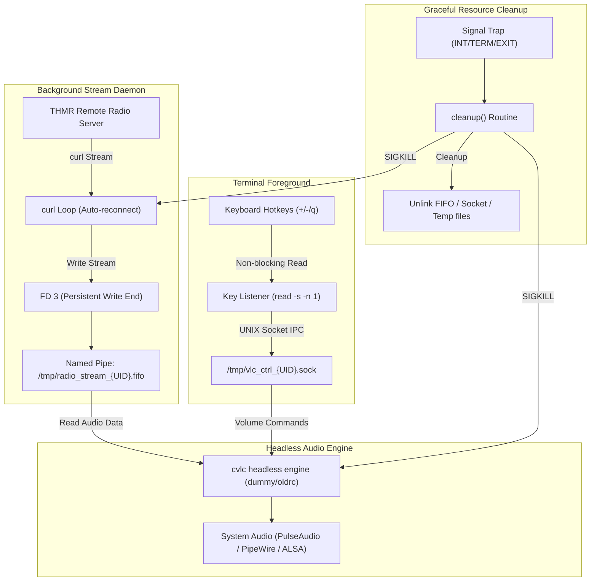

<div align="center">

# thmr-cli

**A lightweight Linux & macOS command-line streaming client for [Touhou Music Radio (thmr-app)](https://github.com/Yunmoan/thmr-app)**

[](LICENSE)
[](#)
[](#)
[](#)

[English](README_EN.md) • [简体中文](README.md)

</div>

---

### 📖 Introduction

`thmr-cli` is a lightweight, pure-Bash command-line streaming player designed specifically for **[THMR (Touhou Music Radio / 东方音乐电台)](https://github.com/Yunmoan/thmr-app)**, originally created and maintained by [Yunmoan](https://github.com/Yunmoan).

Crafted for Linux terminal lovers, developers, headless workstations, and minimal environments, `thmr-cli` lets you enjoy 24/7 non-stop, high-fidelity (320kbps) Touhou Project doujin music broadcasts with a single bash script.

---

### ✨ Features

- 🛡️ **Strict Security & Principle of Least Privilege**
  - **Root Execution Guard**: Strictly forbids running as `root` to prevent privilege escalation risks and comply with VLC's built-in root restriction (`VLC is not supposed to be run as root`).
  - **On-Demand Granular Privilege Escalation**: Runs completely under an unprivileged user. Only invokes `sudo` when system packages are missing to install required dependencies, immediately relinquishing elevated privileges afterwards. If dependencies are already installed, `sudo` is never touched.
- 🌐 **Dual Nodes & Network Protocol Flexibility**
  - **Dual Streaming Routes**: Toggle between the Domestic Node (`radio.zyghit.cn`) and the International Node (`radio.yunmoan.cn`).
  - **IP Protocol Control**: Support for Force IPv4 (`-4`), Force IPv6 (`-6`), or Automatic Dual-Stack resolution.
- 🔄 **Continuous Streaming & FIFO Isolation**
  - **EOF-Shielded Named Pipe**: Utilizes named pipes (`mkfifo`) paired with persistent descriptor locking (`exec 3<>`), preventing VLC from quitting due to EOF events during song transitions or transient network hiccups.
  - **Smart Reconnection Daemon**: An independent background `curl` loop automatically detects stream disconnects and retries with backoff protection (resets failure count after 10 seconds of successful playback).
- 🎛️ **Headless VLC Backend & UNIX Socket IPC**
  - Powered by headless `cvlc` (`-q -I dummy --no-video`), ensuring minimal memory and CPU overhead.
  - Full IPC control over a local UNIX Domain Socket using `socat` or `nc`.
  - **Instant Hotkeys**: Non-blocking keypress detection without requiring Enter key confirmations.
- 🧹 **Atomic Cleanup & Zero Resource Leaks**
  - Global `trap cleanup INT TERM EXIT` handles all exit paths.
  - Automatically terminates child process trees (`curl`, `cvlc`), removes temporary FIFOs, sockets, and logs.

---

### 📦 Prerequisites & Dependencies

`thmr-cli` runs on standard Linux environments and relies on the following tools:

| Dependency | Purpose | Minimum Version |
| :--- | :--- | :--- |
| **Bash** | Script execution shell | 4.0+ |
| **curl** | High-performance audio streaming & API calls | Any standard release |
| **vlc** (`cvlc`) | Audio decoding & playback engine | VLC 3.x+ |
| **socat** or **nc** | UNIX domain socket IPC controller | Either one |
| **jq** or **python3** | JSON parsing for live track status & feedback submission | Either one |

> [!TIP]
> **Automatic Dependency Installation**: On **Debian/Ubuntu** or **RHEL/CentOS/Fedora/Rocky/AlmaLinux**, the script will automatically detect missing packages and offer to install them via `sudo`.
> 
> For other distributions, please install dependencies manually as shown below.

#### Manual Installation

```bash
# Debian / Ubuntu / Linux Mint
sudo apt-get update && sudo apt-get install -y curl vlc socat

# Fedora / RHEL / CentOS / Rocky Linux / AlmaLinux
sudo dnf install -y curl vlc socat

# Arch Linux / Manjaro
sudo pacman -S curl vlc socat

# openSUSE
sudo zypper install curl vlc socat

# Alpine Linux
sudo apk add bash curl vlc socat
```

---

### 🚀 Quick Start

#### 1. Clone the repository

```bash
git clone https://github.com/syameimaru-ayaya/thmr-cli.git
cd thmr-cli
```

#### 2. Make the script executable

```bash
# Linux
chmod +x thmr-cli-linux.sh

# macOS
chmod +x thmr-cli-macos.sh
```

#### 3. Launch (⚠️ Do NOT run as root or with sudo)

```bash
# Linux
./thmr-cli-linux.sh

# macOS (Zero external dependencies, native AVPlayer acceleration)
./thmr-cli-macos.sh
```

---

### 🎮 Usage & Controls

When prompted upon startup:

1. **Select Radio Channel**:
   - The Linux client dynamically fetches enabled channels, track counts, and listener counts from the backend (`/api/channels` & `/api/stations`) on startup (automatically falling back to built-in `touhou` / `touhou-curated` defaults if offline or timed out)
   - Enter an index (`1..N`) or a channel ID (e.g., `touhou`, `touhou-curated`)
   - *(Press Enter to select `1` by default)*
2. **Select Streaming Route**:
   - `1`: Domestic Server (`radio.zyghit.cn`) [Recommended for Mainland China]
   - `2`: International Server (`radio.yunmoan.cn`) [Global node]
   - *(Press Enter to select `1` by default)*
3. **Select Audio Bitrate Profile**:
   - The Linux client dynamically lists enabled bitrate profiles for the chosen station sorted from highest to lowest (typically `320k`, `128k`, `96k`, etc.; falls back to default profiles when unavailable)
   - Enter an index (`1..M`) or a bitrate ID (e.g., `128k`)
   - *(Press Enter to select `1`, highest quality, by default)*
4. **Select IP Protocol**:
   - `1`: Force IPv4 (`-4`)
   - `2`: Force IPv6 (`-6`)
   - `3`: Dual-Stack (Auto)
   - *(Press Enter to select `3` by default)*

> [!TIP]
> **Quick Launch**: Arguments can be passed directly to skip interactive prompts (the Linux client accepts either indices or channel/bitrate IDs):
> - `./thmr-cli-linux.sh 1 1 1 3` (1st channel + Domestic source + Highest quality + Dual-Stack)
> - `./thmr-cli-linux.sh touhou-curated 1 128k 3` (Launch directly by channel ID and bitrate ID)
> - `./thmr-cli-macos.sh 1 1 1 3` (macOS native quick launch)

#### Hotkeys during Playback

Once the stream starts, control playback directly in the terminal (**no Enter key needed**):

| Key | Action | Description |
| :---: | :--- | :--- |
| `+` or `=` | **Volume Up** | Increases volume (+5% on macOS / +2 steps on Linux) with visual volume bar |
| `-` or `_` | **Volume Down** | Decreases volume (-5% on macOS / -2 steps on Linux) with visual volume bar |
| `Space` or `p` | **Pause / Resume** | Toggle playback pause/resume |
| `m` or `M` | **Mute Toggle** | Toggle audio mute |
| `h` or `H` | **Track History** | Inspect previous track from server and recent session history |
| `f` or `r` | **Track Feedback** | Report non-Touhou/audio glitch, triggers auto-skip at 5 feedbacks |
| `q` or `Q` | **Graceful Quit** | Terminates streaming and cleans up all processes |
| `Ctrl + C` | **Force Interruption** | Safely triggers cleanup trap and exits |

#### MPRIS Desktop Media Controls

The script automatically enables VLC's native MPRIS when `dbus-send`, the current user's D-Bus session bus, and VLC's `dbus` module are available. Use desktop media controls, media keys, or optional `playerctl` for playback, pause, stop, and volume. Otherwise, terminal controls remain available without additional required dependencies.

Startup prints a command for this VLC instance, for example:

```bash
playerctl --player=vlc play-pause
playerctl --player=vlc status
playerctl --player=vlc volume 0.5
```

If another VLC instance is running, the name may be `vlc.instance12345`. Replace `vlc` with the name printed at startup to target the correct player.

The desktop identifies the player as VLC with the title “THMR 东方音乐电台”. This continuous live stream does not support track switching, seeking, or live song/artist/artwork metadata. VLC 3.x may still expose previous/next buttons; pressing them may stop the stream, which can be resumed with Play. Resuming after a pause may play buffered audio and introduce live latency. `Stop` keeps the application running; MPRIS `Quit` exits and cleans up the stream processes and temporary files.

---

### 🏗️ Architecture Overview



---

### ❓ Troubleshooting & FAQ

<details>
<summary><b>Q1: Why does it warn "Do NOT run this script as root"?</b></summary>

1. **Security**: Streaming network content with root privileges is unsafe.
2. **VLC Incompatible**: VLC rejects root privileges by design (`VLC is not supposed to be run as root. Sorry.`).
3. The script escalates permissions via `sudo` **only when installing dependencies**, so you should always run it as a regular user:
   ```bash
   ./thmr-cli-linux.sh
   ```
</details>

<details>
<summary><b>Q2: What if there's no sound on my VPS?</b></summary>

Headless cloud servers usually do not have physical audio output devices. You will need to route audio over SSH or configure remote PulseAudio/PipeWire forwarding to listen locally.
</details>

<details>
<summary><b>Q3: Does track switching cause playback to terminate?</b></summary>

No. By reserving a read/write descriptor (`exec 3<> "$FIFO_PATH"`), the FIFO pipe never encounters EOF when tracks switch or when network packets momentarily pause, ensuring smooth, non-stop radio playback.
</details>

---

### 🤝 Upstream Project & Credits

- Upstream Web & App project: **[THMR (Touhou Music Radio)](https://github.com/Yunmoan/thmr-app)** by [@Yunmoan](https://github.com/Yunmoan)
- Radio stream backends: [thmr.yunmoan.cn](https://thmr.yunmoan.cn) / [radio.zyghit.cn](https://radio.zyghit.cn)
- Touhou Project is created by **Team Shanghai Alice (ZUN)**. All music rights belong to the respective original circles and creators.

---

### 📄 License

This project is licensed under the [BSD 3-Clause License](LICENSE).
